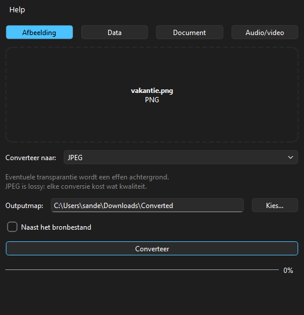

# UniConv

A local, installable desktop app that converts one file at a time within one family:
image, data, document or audio/video. Drop a file, pick a target format, done. Nothing
leaves your machine: there are no uploads and no network calls.



## Supported formats

| Family | From | To |
|---|---|---|
| Afbeelding (image) | JPG, PNG, WebP, GIF, BMP, TIFF, HEIC | JPG, PNG, WebP, GIF, BMP, TIFF, PDF |
| Data | CSV, XLSX, JSON, YAML, TOML, XML | the same six |
| Document | Markdown, HTML, LaTeX, DOCX, ODT, EPUB, RTF | the same seven plus plain text |
| Audio/video | MP3, WAV, FLAC, OGG, M4A, Opus, MP4, MKV, WebM, MOV | audio to any audio format; video to any audio or video format |

`python -m uniconv formats` prints the exact list per source format. Conversions between
families (for example JPG to DOCX) are out of scope. When a conversion loses information
(transparency to JPG, styling from DOCX, video to MP3), the app tells you before and after.

## Install

Download the latest release from the
[Releases page](https://github.com/Forgeline-Optimizations/UniConv/releases).

### Windows 10/11 (x64)

Run `UniConv-<version>-windows-x86_64-setup.exe`. It installs per user (no admin rights)
into `%LOCALAPPDATA%\Programs\UniConv`, and a new version installs over the old one.

The installer is not code-signed, so SmartScreen may show "Windows protected your PC".
Click **More info**, then **Run anyway**.

### macOS 12+ (Apple Silicon)

Open `UniConv-<version>-macos-arm64.dmg` and drag UniConv to Applications. Intel Macs are
not supported.

The app is signed ad hoc, not with an Apple Developer ID, so Gatekeeper blocks the first
start. On macOS 15 and later: open UniConv once, then go to **System Settings → Privacy &
Security** and click **Open Anyway**. On macOS 12-14: right-click the app, choose **Open**,
then **Open** again.

## Where UniConv keeps its files

| What | Windows | macOS |
|---|---|---|
| Your settings (`config.json`) | `%LOCALAPPDATA%\UniConv\config.json` | `~/Library/Application Support/UniConv/config.json` |
| All settings with defaults (`config.defaults.json`) | `%LOCALAPPDATA%\UniConv\` | `~/Library/Application Support/UniConv/` |
| Work folder (temporary files) | `%LOCALAPPDATA%\UniConv\Cache\work` | `~/Library/Caches/UniConv/work` |
| Log | `%LOCALAPPDATA%\UniConv\Logs\uniconv.log` | `~/Library/Logs/UniConv/uniconv.log` |
| Default output folder | `Downloads\Converted` | `~/Downloads/Converted` |

The **Help** menu opens the config and log folders. Uninstalling removes the app only;
delete the folders above to remove settings and logs too.

Converted files are first written to the work folder and moved to the output folder only
when the conversion succeeded, so a failed or cancelled conversion never leaves a half
file behind.

## Settings

The window lets you choose the output folder, or "next to the source file". Everything
else lives in `config.json`. The app writes `config.defaults.json` with every key and its
default at each start. Copy only the keys you want to change into `config.json`:

```json
{
  "behavior": { "overwrite": "overwrite", "open_folder_after_convert": true },
  "defaults": {
    "image": { "jpeg_quality": 85 },
    "media": { "audio_bitrate": "320k", "video_crf": 20 }
  }
}
```

| Key | Default | Meaning |
|---|---|---|
| `behavior.overwrite` | `rename` | `rename` (`photo (1).png`), `overwrite` or `skip` when the target exists |
| `limits.timeout_seconds` | `900` | Stop a conversion that takes longer |
| `limits.max_input_mb` | `4096` | Refuse larger input files |
| `defaults.image.jpeg_quality` / `webp_quality` | `90` / `85` | Lossy image quality |
| `defaults.image.flatten_background` | `#FFFFFF` | Colour behind transparent pixels for JPG/BMP/PDF |
| `defaults.image.max_megapixels` | `150` | Refuse larger images |
| `defaults.data.encoding` | `auto` | Text encoding; `auto` tries UTF-8, then Windows-1252 |
| `defaults.data.csv_delimiter` | `,` | Delimiter for CSV output (input is detected) |
| `defaults.document.embed_resources` | `true` | HTML output with images embedded |
| `defaults.media.video_crf` / `video_preset` | `23` / `veryfast` | H.264 quality and speed |
| `defaults.media.audio_bitrate` | `192k` | Bitrate for lossy audio |

An invalid `config.json` never stops the app: it is renamed to `config.invalid.json` and
the defaults are used. An invalid value for a family is reported when the app starts.

## Command line

The same engine is available as a CLI, which is useful for scripts and for reproducing
bug reports:

```bash
python -m uniconv formats
python -m uniconv convert photo.heic --to png --out ./converted
python -m uniconv convert data.csv --to json        # next to the input
```

The installed Windows app is a windowed program without a console, so use the CLI from a
development install.

## Development

Requires Python 3.12.

```bash
python -m venv .venv
.venv/bin/pip install -e ".[dev]"        # Windows: .venv\Scripts\pip
python scripts/fetch_binaries.py         # pinned Pandoc + ffmpeg into vendor/<platform>/
ruff check . && pytest -q                # QT_QPA_PLATFORM=offscreen on headless machines
python -m uniconv                        # start the window
```

Without `vendor/`, the document and media families are hidden and their tests skip.
Building the installers locally:

```bash
pip install -e ".[build]"
pyinstaller packaging/uniconv.spec --noconfirm
iscc /DAppVersion=0.1.0 packaging/windows/installer.iss    # Windows, Inno Setup 6
bash packaging/macos/build_dmg.sh 0.1.0                     # macOS
```

Pushing a tag `v<version>` (matching `uniconv.__version__`) builds, smoke-tests and
publishes both installers. Running the `release` workflow manually does the same without
publishing.

Architecture: the UI (`src/uniconv/ui`) and the CLI only build a `Job` and call
`JobRunner.run()`. Each converter in `src/uniconv/converters` declares its own formats and
options, so adding a family is one new file plus one line in `build_default_registry()`.

## License

UniConv is licensed under the GNU General Public License v3.0 or later (`LICENSE`). The
installers bundle Pandoc and FFmpeg, which are GPL, and other components listed with their
licenses and source links in [THIRD_PARTY_LICENSES.md](THIRD_PARTY_LICENSES.md).
